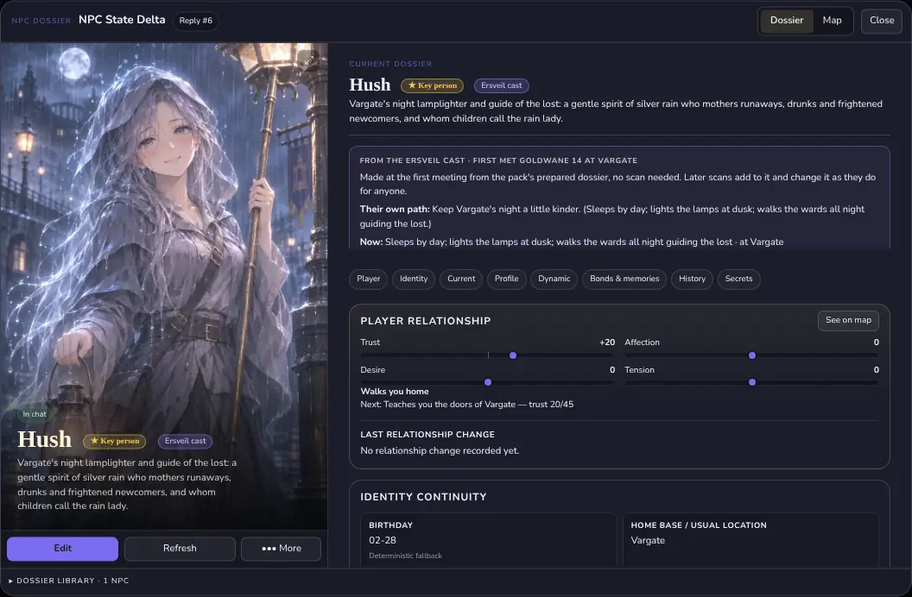
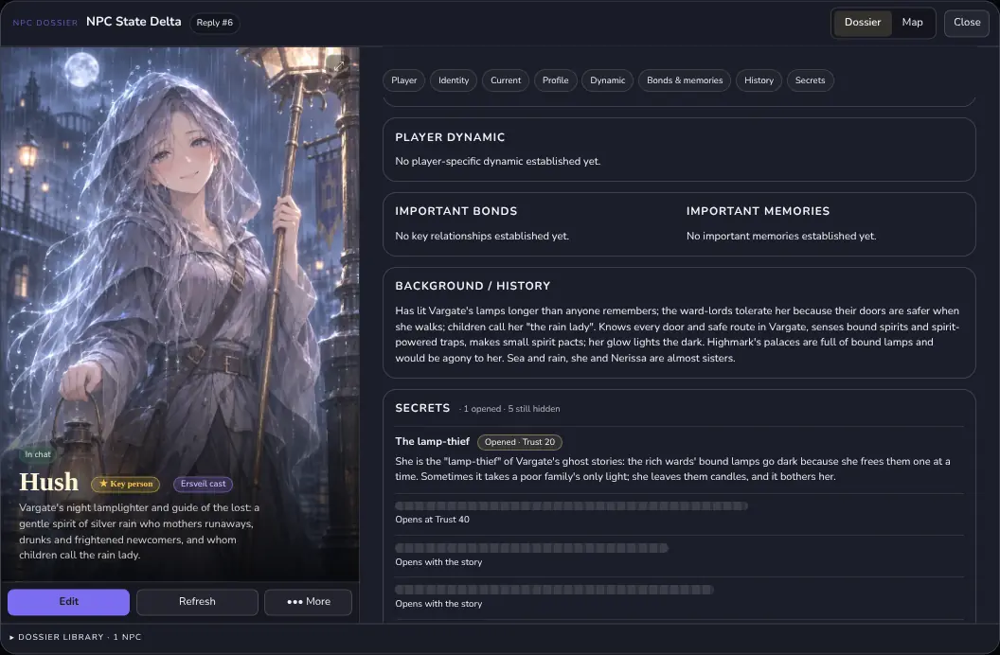
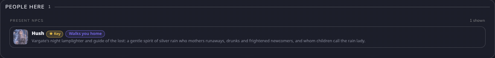
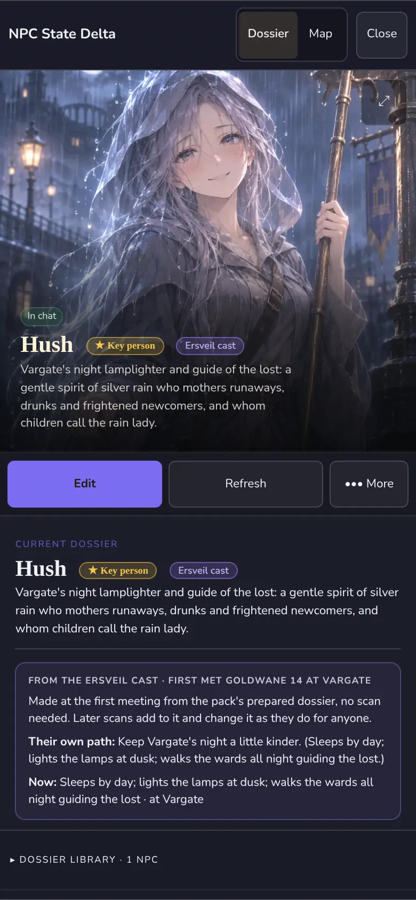

# NPC State Delta v1.8.0 ("Delta")

NPC State Delta keeps a dossier for every person you meet in your story. It is the people part of the Story Suite, an add-on for [SillyTavern](https://github.com/SillyTavern/SillyTavern). AI assistants can read [AI-README.md](AI-README.md) for a dense map of this repo.

## What it is

A dossier holds who a person is, how they look, how they talk, what they remember and how they feel about you. After each reply Delta reads the scene and updates a dossier only where the story gives evidence. It sends the people who are present back to the roleplay model, so they stay in character.

With [Story Block](https://github.com/kohz87/Story_block) it also gives each person meters (trust, affection, desire, tension), stages, and hidden notes called secrets. With [Story Director](https://github.com/kohz87/Story_director) it follows the pack's living cast and the people you pin as Key people.



*A person you meet from a pack's cast gets a dossier at once, with the pack's portrait.*

## Install

Tested with **SillyTavern 1.19**. In **Extensions, Install extension**, install in this order, then reload:

1. [Story Block](https://github.com/kohz87/Story_block) (2.12.0 or later)
2. [Story Director](https://github.com/kohz87/Story_director) (optional, but it adds the cast and Key people)
3. [NPC State Delta](https://github.com/kohz87/npc_state_delta)

Story Block comes first. Delta can run without it, with dossiers, scans, portraits and birthdays only. The meters, stages, secrets, Dossiers screen and cast need Story Block.

Using the old Story Block 1? Install the `v1` branch of this repo instead: paste the URL and type `v1` as the branch.

Before you update an existing install, export a backup from **Data & maintenance, Backup / Export**. Report bugs in [this repo's Issues](https://github.com/kohz87/npc_state_delta/issues), with steps to reproduce.

## What you see and do

- **Dossiers.** Story Block's Game view has a **Dossiers** screen (and the Story panel a Dossiers tab). It lists every dossier with a search box, the stage and the meters. Tap one to open it. Without Story Block, the floating button or **Open dossiers** in Delta's settings opens the same dossier view.
- **The dossier.** A portrait, badges, then sections you can jump to: Player, Identity, Current, Profile, Dynamic, Bonds & memories, History and Secrets. **Map** puts the people around you, nearer or farther by warmth, trust, affection, desire or tension. **Dossier library** at the bottom lists everyone.
- **Edit, Refresh, More.** **Edit** changes any field by hand. Tick "Protect edited stable profile fields" and scans leave those fields alone. **Refresh** re-reads the recent story for that one person. **More** has Scan dossier, Portrait, Diagnostics and Archive. **Add NPC** (in Delta's settings) adds someone the scan missed.
- **The reply card.** Under each reply, Story Block's card shows the meters of the people who are here and what that reply changed.
- **People here.** With Story Director, the World screen draws a card for each person present: portrait, name, standing and one line about them. Tap it to open the dossier. Without Story Director, those cards sit at the top of Dossiers.
- **Cast.** When you meet someone from a pack's cast, their dossier appears on that same reply, already written from the pack. A badge such as "Ersveil cast" shows where you first met them. Delta never overwrites a dossier that already exists.
- **Key people.** A person pinned in Story Director wears a "Key person" badge. While they are away, the dossier shows a **While away** timeline, their meters do not drift, and automatic scans leave their written fields alone. Use **Pin as Key people** on a cast dossier to pin them.
- **Secrets.** Each person can hold up to 8 hidden notes. A note opens at a meter value (for example Trust 40), when the story shows an event, or when you open it by hand. A locked note shows only a blank bar and "Opens at Trust 40" or "Opens with the story". The model is told every note of someone who is present: a locked one as "never reveal, but let it shape how they act", an opened one as known to you. When a scan builds a new dossier it also writes 2 to 5 layered notes.
- **Meters and stages.** Trust, affection, desire and tension run from -100 to 100. You can add up to six meters of your own. Named stages need several meters and a story milestone. Code moves the numbers and the stage. The story only proposes.
- **Appearance.** Outfits change without erasing hair, eyes or scars. A person who transforms can have several **named forms** (human, dragon), each with one complete description.
- **Portraits.** Upload one, or build a prompt for SillyTavern's Image Generation under **More, Portrait**. A cast portrait is saved once as its own file in your SillyTavern user files, and the dossier keeps only a short reference. It stays when the pack is removed.
- **Save points and rollbacks.** Swipes, edits, deletes and Story Block's save points take the dossiers back to match the story. A branch opened from a save point waits for the dossiers of the point it came from.
- **Social checks.** A persuade, charm, intimidate or deceive check against a person gets a small bonus or penalty from their meters, stage and disposition, such as "Elula trusts you (+2)". Delta only reads. It sends nothing to the model.



*Hidden notes show only when they open. A locked one never shows its words.*



*The people who are here, as they are now.*



*The dossier on a phone.*

## Looking after a dossier

- **If someone is missing**, use **Add NPC**. If a dossier looks stale, open it and use **Refresh**. For an NPC with named forms, the body belongs in each form instead; Refresh or edit the form.
- A confirmed death archives the dossier. Deceased is final for scans until you correct it by hand.
- Long-absent people are archived after 30 replies, and those auto-archives are deleted after 50. Manual archives and deaths are kept.
- **Data & maintenance** has Backup / Export, Restore / Import, Diagnostics, the chat roster and **Clear chat dossier** (this chat only).

## Settings worth knowing

With Story Block, Delta's panel is in the Story Suite settings window as its own fold. Without it, it is under **Extensions, NPC State Delta**. Switches for the optional mechanics are in Story Suite **Settings, Features**.

| Setting | Where | Default |
|---|---|---|
| Enable NPC State Delta, Auto scan | Top of the panel | on, on |
| Scanner connection profile | Scanning | the chat's connection |
| Scan every | Scanning | 1 reply |
| Scan after every reply (feature) | Features | on (Story Block's Lean preset turns it off: every 3 replies) |
| Maximum active NPCs | Roster & continuity | 40 |
| Hidden notes for new people | Roster & continuity | on |
| Inject present NPC state | Roster & continuity | on |
| NPCs in the dossier, Injection budget | Expert, Advanced | 3 people, 4000 tokens |
| Most a meter moves per reply, Custom meters, Meter stages | Delta's fold, above the panel | 15, none, none |
| Stage ladders, Meter presets (Companion, Rival, Mentor) | Features | on |
| Meters drift each story day | Features | off (needs Story Director's clock) |
| Social checks: strength (%), most a check moves | Delta's fold | 100, 5 |
| Source of truth (NPCs, calendar, scene, game stats) | Expert | Automatic |

Story Block's prompt size shows Delta's dossier as its own row, often 2,000 to 4,000 tokens. Delta's scanner route and last call are in Story Block's **Diagnostics**.

## How a turn works

Delta's scan runs after the reply, as a separate request, and updates the dossier text. The meters move two ways. The scan's relationship changes go through Story Block with the same limits, and the model can also end its reply with a hidden `<Changes>` list. Delta's lines look like this:

```
<Changes>
~ npc Mira | trust: +5 | affection: -2
~ npc Mira | disposition: wary
+ milestone Mira — saved her brother at the bridge
</Changes>
```

Code clamps each meter and holds each change to the cap. The story cannot set a stage. Swipe, delete, Re-read and reload take the changes back with the reply. Details: Story Block's [GUIDE](https://github.com/kohz87/Story_block/blob/main/docs/v2/GUIDE.md), [MODULES](https://github.com/kohz87/Story_block/blob/main/docs/v2/MODULES.md) (section D) and [docs/dev/storysuite-adapter.md](docs/dev/storysuite-adapter.md).

## How the four fit together

The Story Suite has four parts.

- **Story Block** (2.16.1) is the hub. It keeps the story's state, runs the packs and draws the reader's screens.
- **Story Director** (2.9.1) adds the story clock, the map, quests, the world's events and the pack's living cast. It needs Story Block.
- **NPC State Delta** (1.8.0) adds a dossier for each person you meet, with meters, stages and secrets. It needs Story Block; with Story Director it also follows the cast and Key people.
- **Story Studio** (0.6.0) is a separate page where you write packs. It is not an extension.

Install Story Block first, then Story Director, then NPC State Delta if you want it. Data flows one way: you write a pack in Studio and import it in Story Block; Story Director reads what Story Block holds, and NPC State Delta reads both. Nothing flows back to Studio.

## Limits

- Each scan is a separate model call (**Scanning** sets how often). Pick a cheaper scanner connection profile if that matters.
- At most 40 people are active in a chat by default (the setting goes to 100). At most 3 present people go into each reply by default.
- Meters drift needs Story Director's clock. Without it nothing drifts.
- Secrets, meters and stages need Story Block. The cast and Key people need Story Director.
- Delta tells the model only about people who are present, within the injection budget.
- A dossier that was made from a pack's cast keeps the pack's words until play changes them.
- RPG Battle is no longer part of the suite. Existing RPG Battle chats should stay on the versions they were played with.

## Troubleshooting

- **Meters or stages do not move.** The model writes its change lines at the end of the reply. If the reply length setting cuts the reply short, the lines are lost. Raise the reply length.
- **A chat refuses every reply, or opened with empty dossiers.** Update Story Block to 2.16.1 and Delta to 1.7.1. A chat that was stuck heals when it opens.
- **Someone is missing from the list.** Use **Add NPC**, or check **NPC admission** under Scanning.
- **A dossier looks stale or wrong.** Open it and use **Refresh**. Edit a field by hand and protect it from scans.
- **No portrait shows.** Open **More, Portrait**. Generating one needs an image backend set up in SillyTavern's Image Generation.
- **Nothing is injected.** Check **Enable NPC State Delta** and **Inject present NPC state**, then open **Expert, What's sent**.
- **A hidden note will not open.** Check the rule it shows: a meter value or a story event. You can open it by hand in the dossier editor.

## Links

- [Player guide](https://github.com/kohz87/Story_block/blob/main/docs/v2/GUIDE.md), [Changelog](CHANGELOG.md), [Releases and known issues](https://github.com/kohz87/Story_block/blob/main/docs/v2/RELEASES.md)
- For AI assistants: [AI-README.md](AI-README.md)
- How the extensions work alone and together: [docs/STORY_SUITE.md](docs/STORY_SUITE.md)
- Developers: [docs/dev](docs/dev/), [DEVELOPMENT.md](DEVELOPMENT.md), [CLAUDE.md](CLAUDE.md)
- History, decisions and the after-beta list: `suite-notes/` in [kohz87/inventory-block](https://github.com/kohz87/inventory-block/tree/claude/hopeful-babbage-tipaw8/suite-notes)

Licence: [AGPL-3.0](LICENSE). Story Director is MIT-licensed, so you can start your own module from it.
